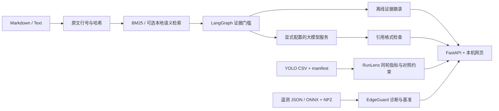

# 架构与状态

接口是本机教学应用，不是多租户生产服务。首版没有用户登录、访问隔离、持久会话、队列或数据库。不能直接把监听地址改成公网地址就当作生产部署。

## 已实现与未验收的边界

| 功能 | v0.1 状态 |
|---|---|
| LangGraph 工作流、中文词法检索、原始行号/哈希 | 实际可运行并有回归测试 |
| 兼容模型 HTTP 适配 | 序列化、错误路径和引用校验通过模拟传输测试；真实模型服务待接入 |
| 语义检索接口与 RRF | 融合逻辑有测试；真实 embedding 模型待验证 |
| YOLO CSV 汇总和实验条件比较 | 合成及异常输入测试；真实实验导入待授权数据 |
| 诊断规则 | 合成记录与异常/未知测试；非设备验收 |
| ONNX 基准 | 可选集成测试验证 CPU Identity 小模型；真实视觉模型与硬件另行验收 |
| LoRA 微调、Qdrant、重排序、昇腾部署 | 路线图内容，尚未实现 |

选用 LangGraph 为了让状态和分支可检查，而非声称有自主多智能体系统。当前节点不执行 shell、不访问控制硬件、不主动触发训练。

来源： [LangGraph Graph API](https://docs.langchain.com/oss/python/langgraph/graph-api)、[FastAPI](https://fastapi.tiangolo.com/tutorial/)、[ONNX Runtime Python API](https://onnxruntime.ai/docs/api/python/api_summary.html)。
